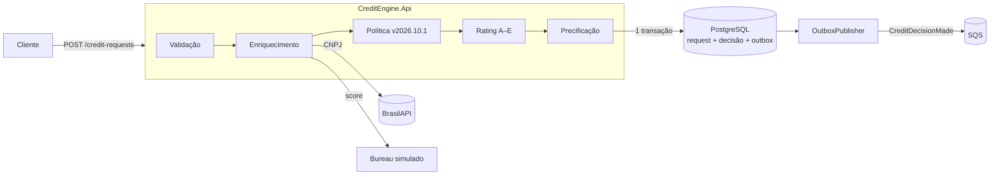

# Motor de Crédito PJ

[](https://github.com/Bugvoid/motor-credito-pj/actions/workflows/ci.yml)

API em **.NET 10** que decide crédito para empresas de médio porte. Ela:
- enriquece o pedido com os dados cadastrais reais do CNPJ (BrasilAPI) e um score de bureau;
- avalia uma **política de crédito escrita como código**;
- calcula o rating e precifica (CDI + spread, Price/SAC, IOF, CET);
- grava uma **decisão auditável**, publicando o evento no SQS via **transactional outbox**.



## Rodando

Pré-requisito: Docker.

```bash
docker compose up -d --build
```

- Swagger: http://localhost:8080/swagger
- Fila SQS local (ElasticMQ): http://localhost:9324

```bash
curl -X POST localhost:8080/credit-requests -H "content-type: application/json" -d '{
  "cnpj": "33.000.167/0001-01",
  "annualRevenue": 250000000, "ebitda": 40000000, "netDebt": 60000000,
  "requestedAmount": 30000000, "termMonths": 36,
  "collateral": "Receivables", "amortization": "Sac"
}'
```

Resposta (resumida):

```json
{
  "id": "01a1596c-...",
  "status": "Approved",
  "rating": "B",
  "policyVersion": "2026.10.1",
  "rules": [
    { "name": "ActiveRegistration", "passed": true, "reason": "situação cadastral ATIVA" },
    { "name": "PostLoanLeverage", "passed": true, "reason": "alavancagem pós-crédito 2,25x (máximo 4,5x)" }
  ],
  "offer": { "spreadAnnual": 0.037, "annualRate": 0.1785505, "iof": 872500.00, "cetAnnual": 0.2053, "schedule": [ ... ] }
}
```

Outros endpoints:
- `GET /credit-requests/{id}`: decisão com a trilha completa.
- `GET /policies/current`: versão, regras e CDI vigentes.
- `GET /health`

## A política

**Elegibilidade.** Todas as regras são avaliadas, sem parar na primeira falha, e ficam gravadas com o motivo:

| Regra | Critério |
|---|---|
| `ActiveRegistration` | CNPJ com situação `ATIVA` na Receita |
| `MinimumAge` | empresa aberta há ≥ 2 anos |
| `RevenueRange` | faturamento anual entre R$ 4,8 mi e R$ 300 mi |
| `AmountToRevenue` | valor ≤ 30% do faturamento |
| `TermRange` | prazo entre 6 e 60 meses |
| `MinimumBureauScore` | score ≥ 300 |
| `PostLoanLeverage` | (dívida líquida + valor) / EBITDA ≤ 4,5x |
| `RatingNotE` | rating diferente de E |

**Rating.** Soma de 0 a 9 pontos:

| Pontos | Alavancagem (DL/EBITDA) | Margem EBITDA | Score |
|---|---|---|---|
| 3 | ≤ 1,0x | ≥ 20% | ≥ 800 |
| 2 | ≤ 2,5x | ≥ 10% | ≥ 600 |
| 1 | ≤ 4,0x | ≥ 5% | ≥ 400 |

As faixas são: 8–9 A · 6–7 B · 4–5 C · 2–3 D · 0–1 E. EBITDA ≤ 0 resulta em E.

**Precificação:**
- Spread por rating: A 2,0% · B 3,5% · C 5,0% · D 7,5%
- Prazo: +0,05 p.p. por mês acima de 12
- Garantia: recebíveis −1,0 p.p. · imóvel −1,5 p.p.
- Piso: 1,0% a.a.
- Taxa = `(1 + CDI) × (1 + spread) − 1`
- IOF PJ: 0,0082% ao dia (até 365 dias) + 0,38%, conforme o Decreto 12.499/2025 (referência: 20/10/2026)
- CET = TIR do valor líquido recebido contra as parcelas

**Decisão:**
- `Approved`: todas as regras passaram.
- `Rejected`: alguma regra falhou.
- `Referred`: a BrasilAPI está fora do ar. A operação vai para análise manual e **nunca** é aprovada sem cadastro.

## Decisões técnicas

- **Domínio puro:** `CreditEngine.Domain` não faz I/O. Regras, rating e precificação são testados sem banco nem rede.
- **Política versionada:** cada decisão grava `policy_version` e o resultado de cada regra (`jsonb`), o que permite responder "por que essa empresa foi recusada em março?".
- **Transactional outbox:** a decisão e o evento são gravados na mesma transação. O `OutboxPublisher` envia ao SQS a cada 2 s e tenta de novo em caso de falha, então nenhum evento se perde se a fila cair. A entrega é *at-least-once*: o consumidor deve ser idempotente pelo `id`.
- **Dinheiro em `decimal`**, com arredondamento só nas parcelas. A última parcela absorve o resíduo, então a soma das amortizações é exatamente o principal.
- **Testes:** 61 no total. São unitários para o domínio e de integração com PostgreSQL real via Testcontainers. Rodam no GitHub Actions a cada push.

```bash
dotnet test   # requer Docker para os testes de integração
```

## Configuração

| Chave | Padrão | Observação |
|---|---|---|
| `Credit:CdiAnnual` | `0.1365` | CDI de 19/10/2026 (série SGS 4389). Para atualizar, use `curl "https://api.bcb.gov.br/dados/serie/bcdata.sgs.4389/dados/ultimos/1?formato=json"` |
| `Outbox:Enabled` | `false` | `true` liga o publicador SQS |
| `Sqs:ServiceUrl` | ElasticMQ local | **Vazio = AWS real**, com região e credenciais da cadeia padrão do SDK |
| `Sqs:QueueUrl` | fila local | URL da fila |

Para usar o **SQS real da AWS** (free tier: 1 milhão de requisições/mês), crie a fila com `aws sqs create-queue --queue-name credit-decisions`, deixe `Sqs__ServiceUrl` vazio e preencha `Sqs__QueueUrl` com a URL devolvida.

## Estrutura

```
src/CreditEngine.Domain/          regras, rating, precificação (sem dependências)
src/CreditEngine.Infrastructure/  EF Core + Npgsql, BrasilAPI, bureau simulado, outbox → SQS
src/CreditEngine.Api/             Minimal API, validação, Swagger, health check
tests/                            xUnit + Testcontainers
```
